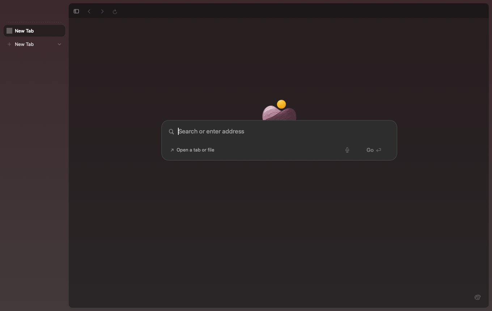
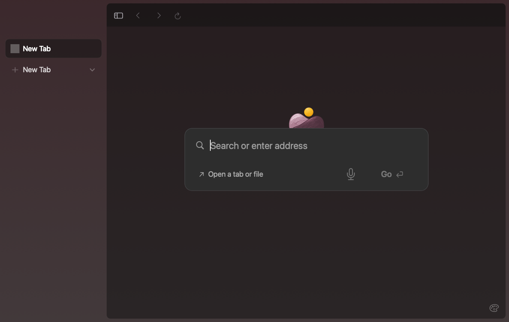

# Application interface size

Choose Settings › Appearance › Interface size to enlarge Ardia's text, icons, controls and supporting layout. The available sizes are 100%, 110%, 125% and 150%. Reset restores 100%.

The preference applies immediately across browser, settings and Little Ardia windows. It is saved on this Mac and excluded from sync. Website zoom, page content and macOS display settings remain independent. AppKit menus and system dialogs retain their system sizing.

Baseline dimensions stay immutable. A shared metrics resolver supplies state geometry and a state-free UI context. Text and native glyph wrappers scale baseline values once; their enclosing frames and hit areas use displayed dimensions. Sidebar widths remain stored in baseline units. Changing size invalidates drag sessions and geometry caches.

Session schema 12 supplies the default for older sessions, and the native session reader accepts the same version. Native launch-layout state includes the validated nondefault size so cached page geometry cannot be reused at another scale.

The existing consent-controlled settings snapshot records the size enum and whether it is the default. This adds no separate telemetry event or consent path.

## Example

100%:

150%:

These captures use an isolated development profile with a neutral New Tab page.
